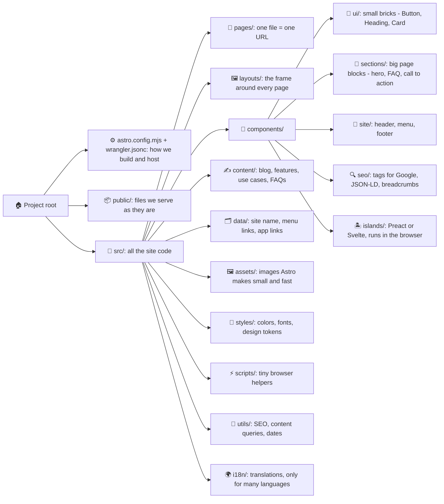
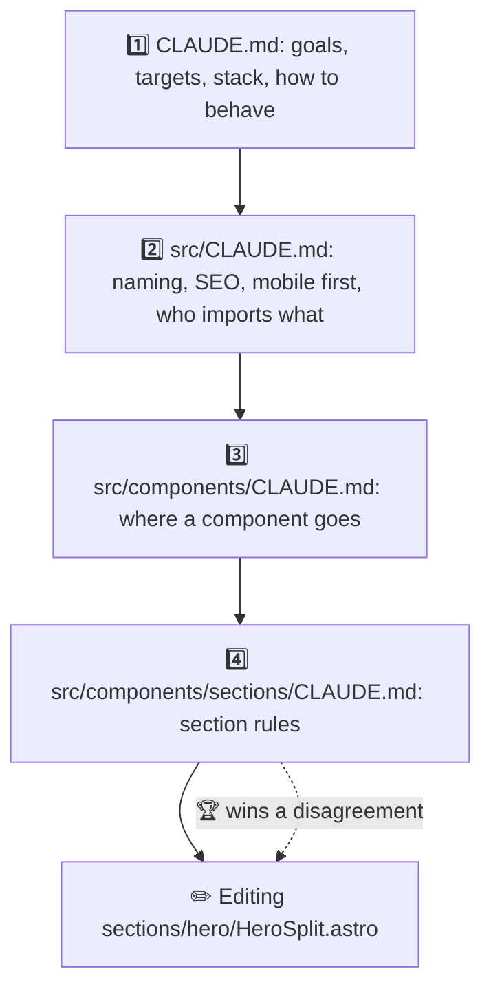
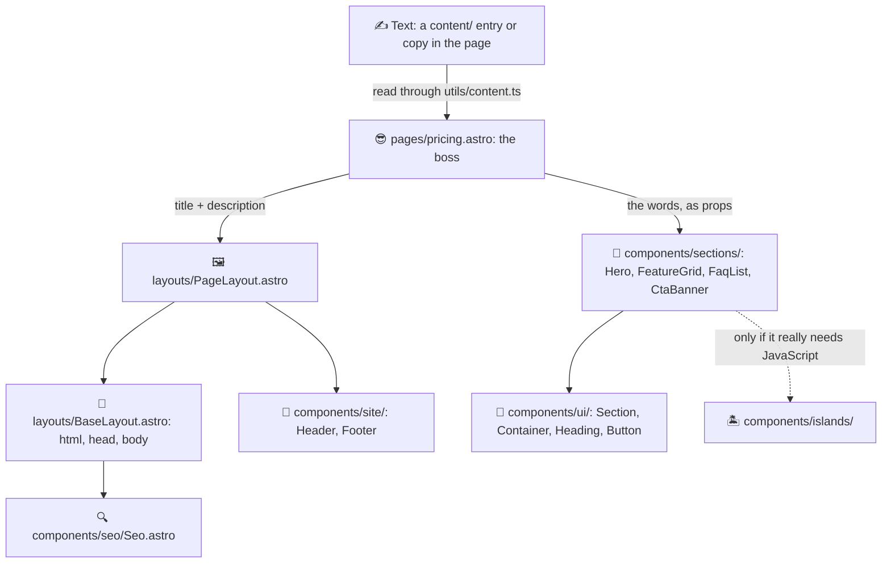
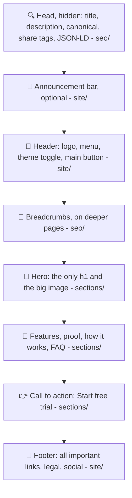
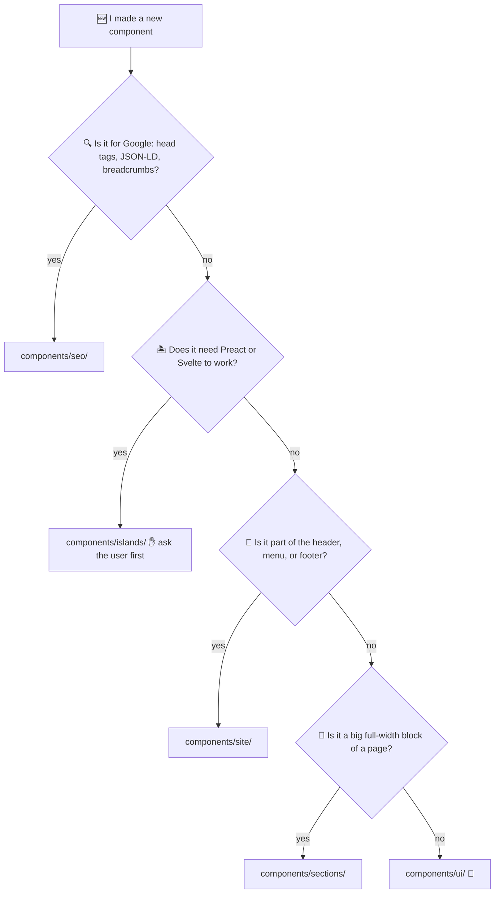
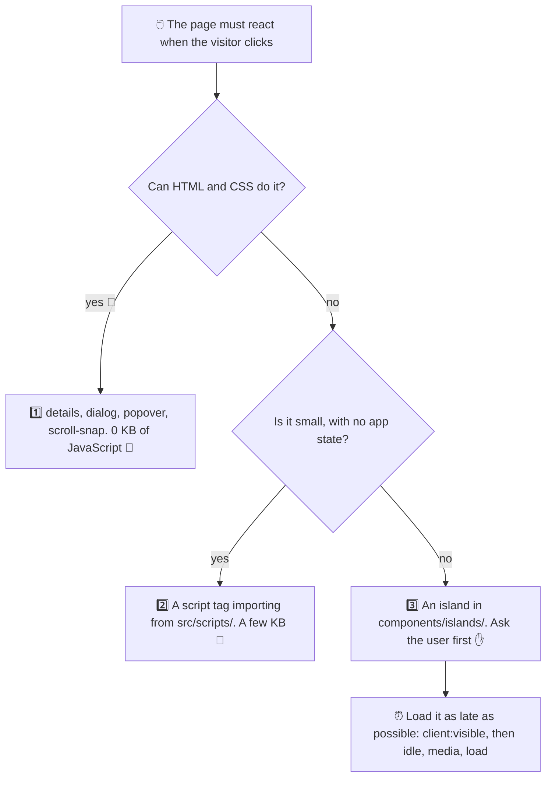
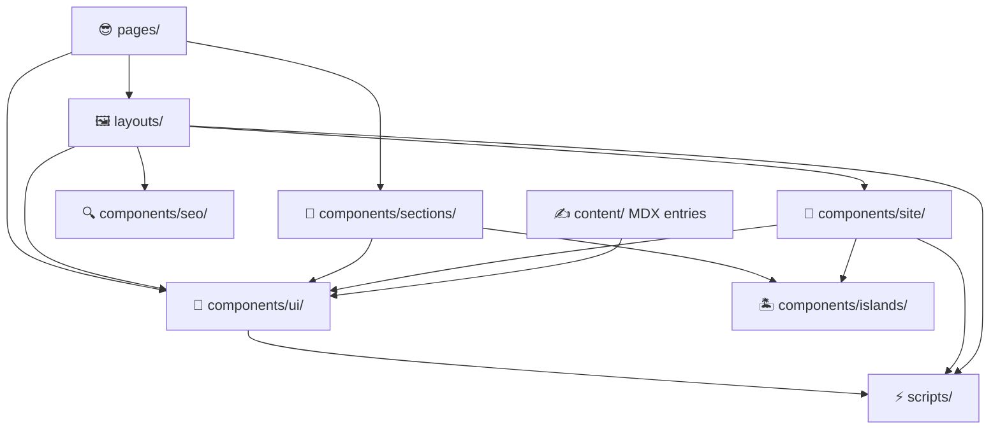
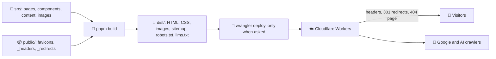

# Astro Template 🚀

Rules for building a public website with Astro: the marketing site, product pages, use cases, and blog of a product. The site is fully static, and Cloudflare Workers hosts it. Fast like a cheetah 🐆, friendly like a golden retriever 🐕.

## What Is This? 🤔

It is a set of `CLAUDE.md` files, one per folder. Copy them into your project and keep the same folder paths. Claude Code reads the `CLAUDE.md` of the folder it is working in. So the rules for a folder load only when Claude works there. No rule overload 🧠💥.

- These files are the rules 📜.
- [ASTRO_GUIDELINE.md](../ASTRO_GUIDELINE.md) is the index. It points to them.
- [GENERAL_GUIDELINE.md](../GENERAL_GUIDELINE.md) covers how the agent behaves in every stack.

This site has one job: Google must find it 🔍, and visitors must love it ❤️. So the rules care about four things, in this order:

1. 🔍 **Found** - SEO first.
2. ⚡ **Fast** - almost no JavaScript.
3. 😍 **Clear and delightful** - great UI/UX, mobile first.
4. 🧹 **Easy to change** - clean code anyone can read.

Building an app behind a login? Wrong door 🚪. Use [react/](../react/) instead.

## Files 📂

| File | What it covers |
|------|----------------|
| `CLAUDE.md` | 🏠 The big rules: goals and targets, stack, commands, how to talk and plan, `astro.config.mjs` and `wrangler.jsonc`, MCP servers. |
| `public/CLAUDE.md` | 📦 Files served as they are: favicons, the default share image, `_headers`, `_redirects`. |
| `src/CLAUDE.md` | 🧠 Rules for all site code: naming, imports, the interactivity ladder, SEO on the page, mobile first, accessibility, motion, copy, libraries, the import table. |
| `src/assets/CLAUDE.md` | 🖼️ Images Astro makes small: `<Image>` and `<Picture>`, sizes for each screen, the main image, alt text, video. |
| `src/components/CLAUDE.md` | 🧩 Which folder a component goes in, component files, slots, variants, updating every place it is used. |
| `src/components/ui/CLAUDE.md` | 🧱 Small bricks such as `Button`, `Section`, and `Heading`, with accessibility built in. |
| `src/components/sections/CLAUDE.md` | 🍰 Big page blocks such as the hero and the FAQ: words come in as props, phone order, the main image, real proof only. |
| `src/components/site/CLAUDE.md` | 🧭 The header, the menu, the mobile menu, and the footer. |
| `src/components/seo/CLAUDE.md` | 🔍 `Seo.astro` head tags, JSON-LD, breadcrumbs, the sitemap filter, `llms.txt`. |
| `src/components/islands/CLAUDE.md` | 🏝️ Components that run in the browser: when one is allowed, which `client:*` directive, props. |
| `src/content/CLAUDE.md` | ✍️ Content collections and their schemas, how to read them, how to write copy that ranks, MDX. |
| `src/data/CLAUDE.md` | 🗂️ Typed site data: site details, menu links, links into the product app. |
| `src/i18n/CLAUDE.md` | 🌍 Translations and URLs per language. Only for sites with more than one language. |
| `src/layouts/CLAUDE.md` | 🖼️ The frame of every page: `BaseLayout`, `PageLayout`, `ArticleLayout`, analytics, page transitions. |
| `src/pages/CLAUDE.md` | 📄 One file per URL: URL rules, what a page does, dynamic routes, pagination, 404, `robots.txt`. |
| `src/scripts/CLAUDE.md` | ⚡ Tiny browser helpers loaded by `<script>` tags, and Motion animations. |
| `src/styles/CLAUDE.md` | 🎨 `global.css`: Tailwind, design tokens, fonts, dark mode, focus and motion styles. |
| `src/utils/CLAUDE.md` | 🔧 Small pure helpers: SEO, structured data, content queries, dates. |

This is not the whole tree. Only folders with their own rules get a file. The subfolders of `sections/`, `assets/`, and `content/` grow with the site 🌱, and their rules live in the parent folder's `CLAUDE.md`.

## Diagrams 🗺️

Pictures first, rules later. These diagrams are a map of the template, for humans. The real rules live in the `CLAUDE.md` files. If a diagram and a rule ever fight, the rule wins 🥊 and we fix the diagram.

### 1. 📁 Folder Map

Every folder has one job. Like a kitchen: spoons go in the spoon drawer, not in the fridge.

### 2. 📚 Which Rules Load

Claude reads the root `CLAUDE.md` first. Then it reads one `CLAUDE.md` per folder, on the way to the file it opens. It is like asking for directions: the person standing closest to the place knows best. So when two rules disagree, the closest folder wins 🏆.

### 3. 🏗️ How a Page Is Built

The page is the boss 😎. It does not do the hard work. It picks a layout, gives the SEO data, and tells each section what to say. Sections do the real work, and they are built from small `ui/` bricks. Section 2 of [ASTRO_GUIDELINE.md](../ASTRO_GUIDELINE.md) explains the roles.

### 4. 🍔 Anatomy of a Page

A page is a burger 🍔. Same order every time, from top to bottom. Each layer says which folder makes it.

### 5. 🤔 Where Does My Component Go?

Ask the questions in order. The first "yes" wins. No "yes" at all? It is a small brick, so it goes in `ui/`.

### 6. 🪜 The Interactivity Ladder

Every step down the ladder adds JavaScript, and JavaScript makes the page slower 🐢. So we stop at the first step that works. Most things never leave step 1.

### 7. 🚦 Import Layers

Who may use whom. An arrow means "may import". Arrows only go down, never up. A brick never asks the boss for orders 😄. Almost every folder may also use `utils/` and `data/`. The full table is in `src/CLAUDE.md`.

Two rules people forget: a section never imports another section 🙅, and nothing ever imports a page.

### 8. 🚀 Build and Deploy

We build the whole site once, into plain files. Cloudflare serves them from a server close to each visitor. No server code, nothing to crash at 3 AM 😴.

## Inside Every CLAUDE.md 📋

Every `CLAUDE.md` under `src/` has the same sections, in the same order. Same order everywhere = no treasure hunt 🗺️. Keep new files like this too.

1. **Intro** - what the folder holds, in one or two sentences.
2. **`Structure`** - how the files and subfolders are laid out, and what each one does.
3. **`Rules`** - what to follow while working in the folder.
4. **`Boundaries`** - what the folder may import, and what belongs somewhere else. Skip it if the folder has neither.
5. **`Before You Finish`** - checks to run before the work is done. Only where needed.
6. **`Existing ...`** - a table of what the folder already holds 📇. Claude reads it to find a component or a helper without opening every file. Claude must update it in the same change when it adds, renames, or removes a file. The tables start empty. They fill up as your project grows.
7. **`Open Decisions`** - choices not made yet 🤷. Each one has a default. Claude follows the default until you write your answer after `Decision:`. Then the answer moves into that file's rules, and the item goes away. No items left? The file says "None yet."

The root `CLAUDE.md` is about how Claude behaves, not about one folder. So it has its own layout. But it also ends with `Open Decisions`.

## Naming 🏷️

| What | Style | Example |
|------|-------|---------|
| Components and layouts | `PascalCase.astro` | `FeatureGrid.astro` |
| Islands | `PascalCase.tsx` | `PricingCalculator.tsx` |
| Pages (the file name is the URL!) | `kebab-case` | `use-cases/[slug].astro` |
| Every other file and folder | `kebab-case` | `structured-data.ts` |
| Variables and functions | `camelCase` | `getPostUrl` |
| Constants | `UPPER_SNAKE_CASE` | `HEADER_LINKS` |

## Before You Copy ✅

Three small jobs, and then Claude is ready to work 💪.

1. 📁 **Make a `docs/` folder.** The root `CLAUDE.md` links to `docs/PROJECT_ARCHITECTURE.md` and `docs/PROJECT_GUIDELINES.md`. These paths are inside *your* project, not this repository. Create them, or change the paths. Otherwise the links lead nowhere 👻.
2. ⚙️ **Fill in `Stack` and `Commands`** in the root `CLAUDE.md`. Claude runs those commands before it finishes. So they must be your project's real scripts, not wishes 🌠.
3. 🤷 **Answer the `Open Decisions`** at the bottom of each file. Until you do, Claude follows the defaults.

## Still To Decide 📝

Questions that don't belong to one folder. When you answer one, add the answer to the right `CLAUDE.md`, or create the file if it doesn't exist.

- [ ] 🧹 **ESLint and Prettier:** which preset we enforce, and whether `astro check`, lint, and build run in CI before every deploy.
- [ ] 🧪 **Testing:** no tests for now. Decide whether to add a small Playwright smoke test and Lighthouse CI with the budgets from the root `CLAUDE.md`.
- [ ] 🚚 **Deploys:** who deploys, from which branch, and whether pull requests get a preview URL (kept out of Google with `noindex`).
- [ ] 🍪 **Consent:** a project on Google Analytics 4 with visitors from the EU or UK needs a cookie banner wired to Consent Mode. Decide how we build the banner and where it lives. Cloudflare Web Analytics needs no banner. Fewer cookies, more happy 🍪😄.
