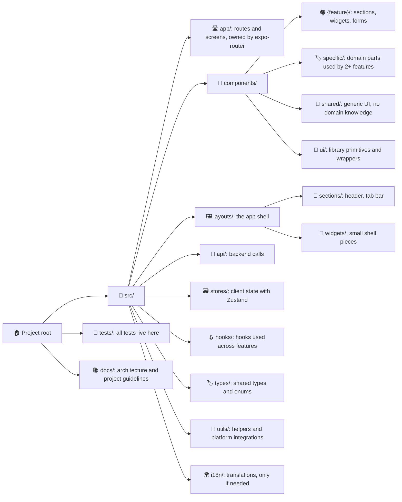
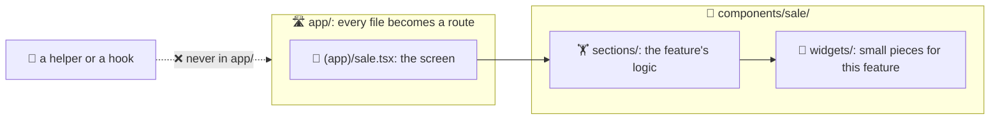
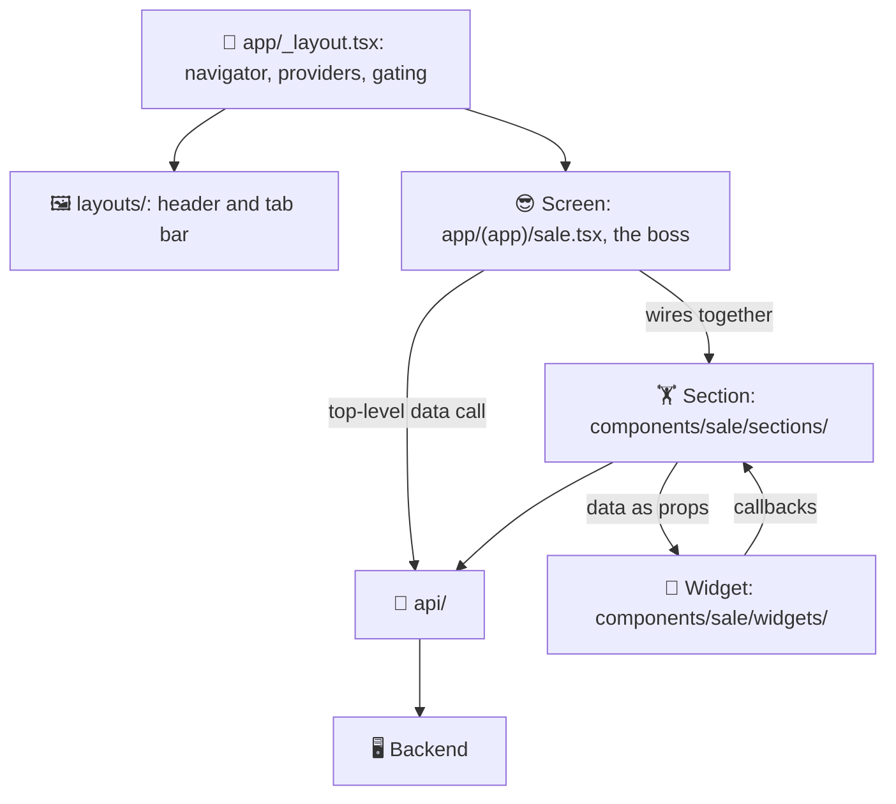
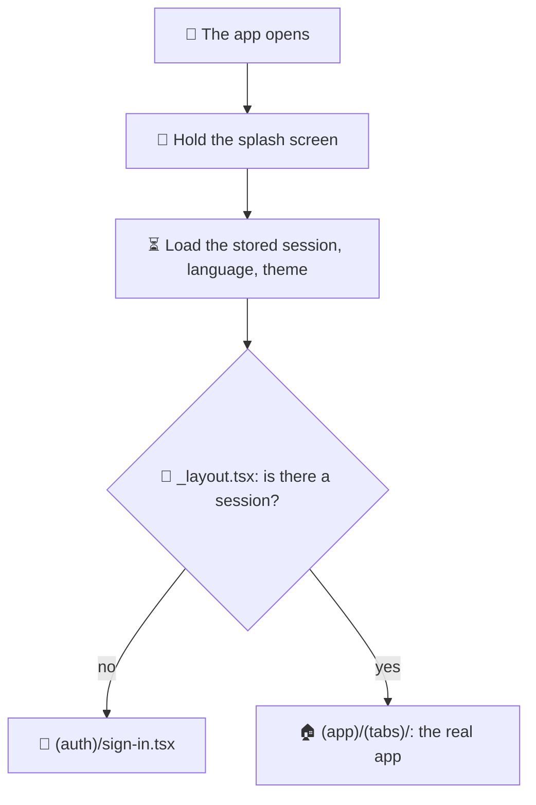
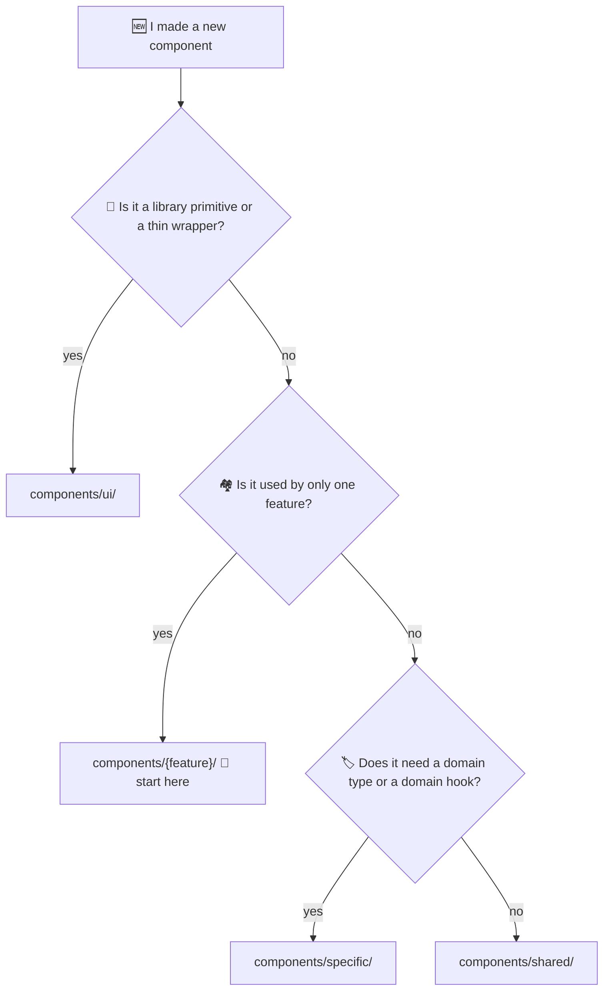

# React Native Template 📱

Rules for a mobile app built with Expo and `expo-router`. One codebase, two platforms, zero excuses 😄. iOS and Android both get love ❤️.

## What Is This? 🤔

It is a set of `CLAUDE.md` files, one per folder. Copy them into your project and keep the same folder paths. Claude Code reads the `CLAUDE.md` of the folder it is working in. So the rules for a folder load only when Claude works there. No rule overload 🧠💥.

- These files are the rules 📜.
- [REACT_NATIVE_GUIDELINE.md](../REACT_NATIVE_GUIDELINE.md) is the index. It points to them.
- [GENERAL_GUIDELINE.md](../GENERAL_GUIDELINE.md) covers how the agent behaves in every stack.

Using React Navigation, or bare React Native without Expo? Wrong door 🚪. This template is not for you. Its routing rules expect `expo-router` to own the `app/` folder.

## Files 📂

| File | What it covers |
|------|----------------|
| `CLAUDE.md` | 🏠 The big rules: how to talk and plan, code output, debugging. |
| `src/CLAUDE.md` | 🧠 Rules for all app code: TypeScript, naming, styling, devices, speed, accessibility. |
| `src/app/CLAUDE.md` | 🛣️ Routes and screens, navigation, gating, headers. |
| `src/api/CLAUDE.md` | 📡 Calls to the backend, grouped by domain. |
| `src/components/CLAUDE.md` | 🧩 Where a component goes, the feature folder layout, native UI, updating every place it is used. |
| `src/components/ui/CLAUDE.md` | 🧱 Library primitives and thin wrappers. |
| `src/components/shared/CLAUDE.md` | 🤝 Generic project UI that knows nothing about any feature. |
| `src/components/specific/CLAUDE.md` | 🏷️ Domain components used by more than one feature. |
| `src/hooks/CLAUDE.md` | 🪝 Custom hooks used across features. |
| `src/layouts/CLAUDE.md` | 🖼️ The app shell. |
| `src/layouts/sections/CLAUDE.md` | 🧭 Big parts of the shell, such as the header and the tab bar. |
| `src/layouts/widgets/CLAUDE.md` | 🔘 Small pieces inside the shell. |
| `src/stores/CLAUDE.md` | 🗃️ Client state with Zustand. |
| `src/types/CLAUDE.md` | 🏷️ Shared types. `api.interface.ts` holds backend response types, `general.enum.ts` holds shared enums. |
| `src/utils/CLAUDE.md` | 🔧 Shared helpers and platform integrations. Look here before you write a new one. |
| `src/i18n/CLAUDE.md` | 🌍 Translation files. Only if the project has translations. |
| `tests/CLAUDE.md` | 🧪 Where tests live and what is worth testing. |

This is not the whole tree. Only folders with their own rules get a file. Each feature creates its own `sections/` and `widgets/` under `components/{feature}/` 🌱, and their rules live in `components/CLAUDE.md`.

## Diagrams 🗺️

Pictures first, rules later. These diagrams are a map of the template, for humans. The real rules live in the `CLAUDE.md` files. If a diagram and a rule ever fight, the rule wins 🥊 and we fix the diagram.

### 1. 📁 Folder Map

Every folder has one job. Like a kitchen: spoons go in the spoon drawer, not in the fridge.

### 2. 🚫 Why the Screen Lives Alone

`expo-router` turns *every* file in `app/` into a screen. Put a helper there, and surprise 🎉, your users can now navigate to your helper. So the screen sits alone in `app/`, and everything it is built from lives in `components/`.

### 3. 🏗️ How a Screen Is Built

Same three roles as the [react/](../react/) template. So a developer moving between the web app and the mobile app keeps one vocabulary 🗣️.

1. 😎 **Screen** - `app/{route}.tsx`. Page structure, wires sections together, owns the top-level data call. Logic stays small.
2. 🏋️ **Section** - `components/{feature}/sections/`. Most of the feature's logic, state, and data handling.
3. 🎨 **Widget** - `components/{feature}/widgets/`. Props in, callbacks out. No business rules.

### 4. 🔐 Who Gets In?

Login and onboarding checks happen in a `_layout.tsx`, never in the screen itself. If the screen checked, the user would see it flash before being pushed away 👻. And we hold the splash screen until we know who the user is.

### 5. 🤔 Where Does My Component Go?

Most components start life in their feature folder 🐣. They move out only on their *second* use. "Maybe someday" is not a second use 😄.

## Naming 🏷️

| What | Style | Example |
|------|-------|---------|
| Files | `kebab-case` | `contact-list.tsx` |
| Components | `PascalCase` | `ContactList` |
| Variables and functions | `camelCase` | `loadContacts` |
| Constants | `UPPER_SNAKE_CASE` | `MAX_LENGTH` |
| Route groups | parentheses | `(auth)` |
| Dynamic segments | named for what they hold | `[saleId]`, not `[id]` |

## Before You Copy ✅

Two small jobs, and then Claude is ready to work 💪.

1. 📁 **Make a `docs/` folder.** The root `CLAUDE.md` links to `docs/PROJECT_ARCHITECTURE.md` and `docs/PROJECT_GUIDELINES.md`. These paths are inside *your* project, not this repository. Create them, or change the paths. Otherwise the links lead nowhere 👻.
2. ✍️ **Fill in the open choices.** The root `CLAUDE.md` ends with a short list of choices this template leaves to you, starting with the styling system. Fill them in before Claude has to guess 🔮.

## Still To Decide 📝

Questions we haven't answered yet. Quite a few, mobile apps have opinions 😅. When you answer one, add the answer to the right `CLAUDE.md`, or create the file if it doesn't exist.

- [ ] 🎨 **Styling:** it varies per project, so `src/CLAUDE.md` only carries principles. Decide whether we want a default anyway - StyleSheet with a theme file, NativeWind, or a UI kit - and where theme tokens live in each case.
- [ ] 📡 **Data fetching:** TanStack Query or plain calls in `api/`. Also the error shape, the loading state, the retry policy, and where cache config lives. `react/` already uses TanStack Query, so that is the natural default.
- [ ] 🧪 **Testing:** which framework, whether we test components at all, and whether we want end-to-end tests with Maestro or Detox. `tests/CLAUDE.md` stays framework-neutral until then.
- [ ] 🧹 **Lint and format:** Biome, or ESLint and Prettier, and whether typecheck and lint run in CI.
- [ ] 📝 **Forms:** which library, and how a validation error shows on a mobile field.
- [ ] 🔑 **Auth and session:** where the token is stored, how it refreshes, and what happens when it expires in the middle of a screen.
- [ ] ⚙️ **Env config:** which variables are public, how they are typed, and how builds per environment are set up.
- [ ] 📸 **Permissions:** where a camera, location, or notification request is made, and what the app does when the user says no.
- [ ] 📴 **Offline:** what works with no network, and whether anything waits in a queue for later.
- [ ] 🚨 **Error reporting and analytics:** which service, and what must never go into an event.
- [ ] 🚀 **Release:** EAS build profiles, versioning, over-the-air updates, and store submission. Decide whether this needs its own `docs/RELEASE.md` in the project.
- [ ] 🎯 **Icons:** `react/` uses Phosphor. Confirm the React Native package works for us, or write down the exception.
- [ ] 🤝 **`shared/` and `specific/`:** do they earn their place on mobile, or should they fold into `ui/` and the feature folders?
- [ ] 📦 **Monorepo:** should the mobile app share types and API code with the web app, and how?
