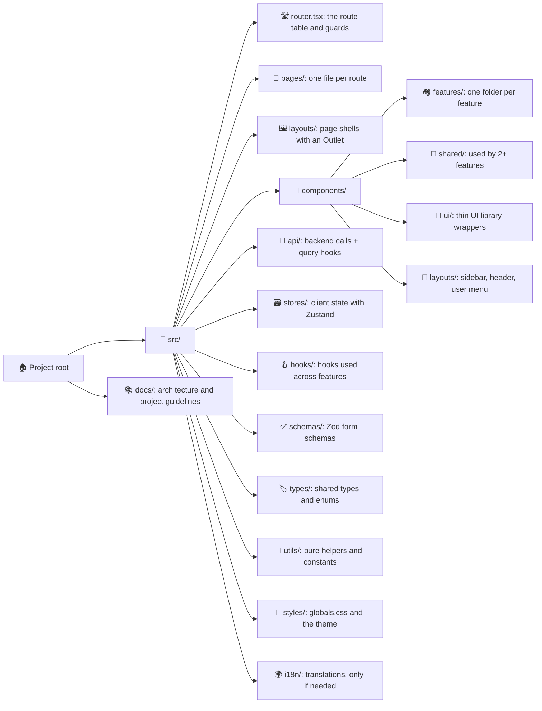
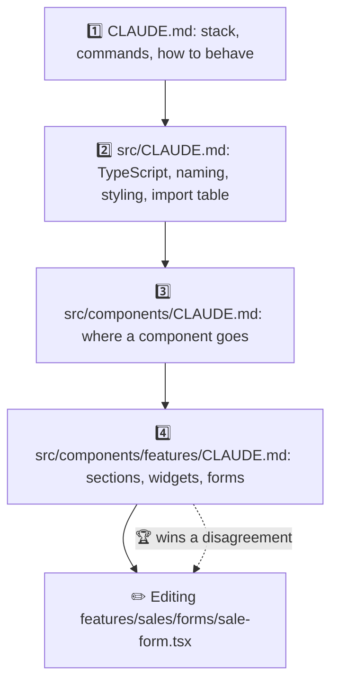
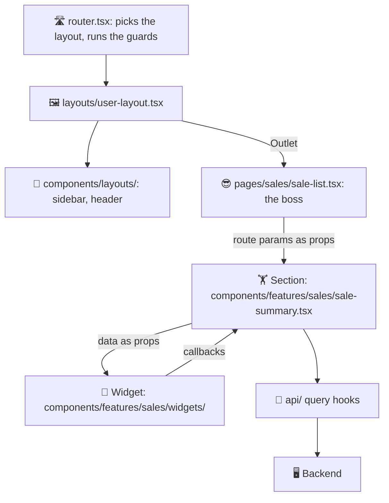
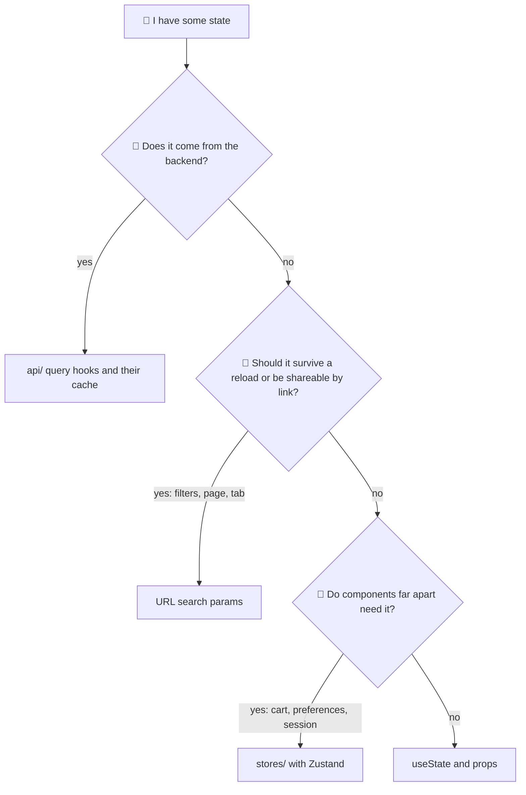
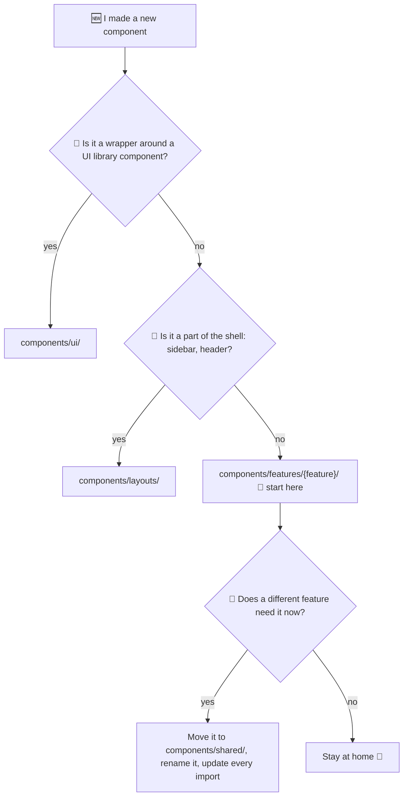
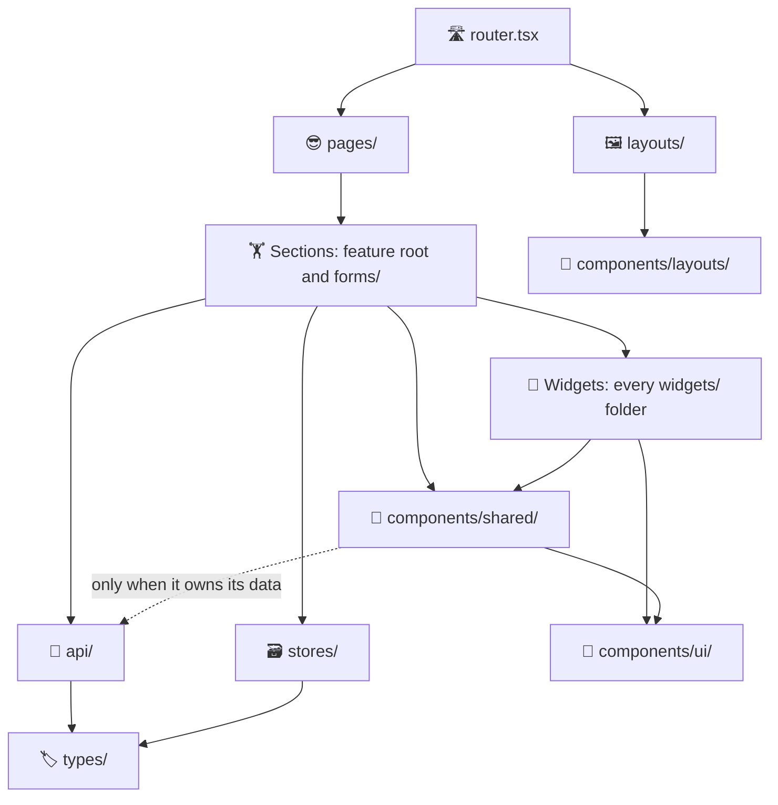

# React Template ⚛️

Rules for a standalone React app, for example one built with Vite ⚡. The kind of app people log in to and use every day. Here, a tidy codebase is not a luxury, it is survival 🧗.

## What Is This? 🤔

It is a set of `CLAUDE.md` files, one per folder. Copy them into your project and keep the same folder paths. Claude Code reads the `CLAUDE.md` of the folder it is working in. So the rules for a folder load only when Claude works there. No rule overload 🧠💥.

- These files are the rules 📜.
- [REACT_GUIDELINE.md](../REACT_GUIDELINE.md) is the index. It points to them.
- [GENERAL_GUIDELINE.md](../GENERAL_GUIDELINE.md) covers how the agent behaves in every stack.

Is your React code inside a Laravel project? Wrong door 🚪. Use [laravel-react/](../laravel-react/) instead.

## Files 📂

| File | What it covers |
|------|----------------|
| `CLAUDE.md` | 🏠 The big rules: stack, commands, how to talk and plan, code output, debugging, MCP servers. |
| `src/CLAUDE.md` | 🧠 Rules for all frontend code: TypeScript, naming, imports, styling, mobile, libraries, security, the import table. |
| `src/api/CLAUDE.md` | 📡 Calls to the backend and their TanStack Query hooks, one file per resource. Error shape, auth, cache. |
| `src/components/CLAUDE.md` | 🧩 Where a component goes, moving it to `shared/`, file layout, props types, composition, updating every place it is used. |
| `src/components/ui/CLAUDE.md` | 🧱 Thin wrappers around the UI library's components. |
| `src/components/shared/CLAUDE.md` | 🤝 Components used by two or more features, including `<Can>`. |
| `src/components/features/CLAUDE.md` | 🏘️ One folder per feature: sections, widgets, `forms/`, feature-only helpers and hooks, form rules. |
| `src/components/layouts/CLAUDE.md` | 🧭 The parts a layout is built from, such as the sidebar and the header. |
| `src/hooks/CLAUDE.md` | 🪝 Custom hooks used across the app, for example `use-debounce.ts`. |
| `src/i18n/CLAUDE.md` | 🌍 Translation files. Only if the project has translations. |
| `src/layouts/CLAUDE.md` | 🖼️ Layout routes. Their parts, such as the sidebar and header, live in `components/layouts/`. |
| `src/pages/CLAUDE.md` | 📄 One file per route page, in a feature folder when a feature has more than one. A page only reads route params, sets the title, and places sections. |
| `src/schemas/CLAUDE.md` | ✅ Zod form schemas. Only if the project validates forms with Zod. |
| `src/stores/CLAUDE.md` | 🗃️ Client state with Zustand, and where each kind of state goes. |
| `src/styles/CLAUDE.md` | 🎨 The global stylesheet and the UI library's theme. |
| `src/types/CLAUDE.md` | 🏷️ Shared types. `api.interface.ts` holds backend response types, `general.enum.ts` holds shared enums. |
| `src/utils/CLAUDE.md` | 🔧 Shared helper functions. Look here before you write a new one. |

This is not the whole tree. Only folders with their own rules get a file. Each feature creates its own sections, `forms/`, and `widgets/` under `components/features/{feature}/` 🌱, and their rules live in `components/features/CLAUDE.md`.

## Diagrams 🗺️

Pictures first, rules later. These diagrams are a map of the template, for humans. The real rules live in the `CLAUDE.md` files. If a diagram and a rule ever fight, the rule wins 🥊 and we fix the diagram.

### 1. 📁 Folder Map

Every folder has one job. Like a kitchen: spoons go in the spoon drawer, not in the fridge.

### 2. 📚 Which Rules Load

Claude reads the root `CLAUDE.md` first. Then it reads one `CLAUDE.md` per folder, on the way to the file it opens. It is like asking for directions: the person standing closest to the place knows best. So when two rules disagree, the closest folder wins 🏆.

### 3. 🏗️ How a Page Is Built

The page is the boss 😎. It does not do the hard work. It reads the route params, sets the title, and places the sections. Sections do the real work: logic, state, and data. Widgets just draw what they are given 🎨.

### 4. 🧳 Where Does This State Go?

Every piece of state has one home. Put it in the wrong home and it gets lost, like socks in a washing machine 🧦.

### 5. 🤔 Where Does My Component Go?

Most components start life in their feature folder 🐣. They move to `shared/` only when a *second, different* feature needs them. Not before. "Maybe someday" is not a second use 😄.

### 6. 🚦 Import Layers

Who may use whom. An arrow means "may import". Arrows only go down, never up. A widget never asks the boss for orders 😄. The full table is in `src/CLAUDE.md`.

Two rules people forget: a widget never touches `api/` or `stores/` 🙅, and a feature never imports from another feature. There is one small exception, in `components/features/CLAUDE.md`.

## Inside Every CLAUDE.md 📋

Every `CLAUDE.md` under `src/` has the same sections, in the same order. Same order everywhere = no treasure hunt 🗺️. Keep new files like this too.

1. **Intro** - what the folder holds, in one or two sentences.
2. **`Structure`** - how the files and subfolders are laid out, and what each one does.
3. **`Rules`** - what to follow while working in the folder.
4. **`Boundaries`** - what the folder may import, and what belongs somewhere else. Skip it if the folder has neither.
5. **`Before You Finish`** - checks to run before the work is done. Only where needed.
6. **`Existing ...`** - a table of what the folder already holds 📇. Claude reads it to find a hook, a helper, or a component without opening every file. Claude must update it in the same change when it adds, renames, or removes a file. The tables start empty. They fill up as your project grows.

The root `CLAUDE.md` is about how Claude behaves, not about one folder. So it has its own layout.

## Naming 🏷️

| What | Style | Example |
|------|-------|---------|
| Files and folders | `kebab-case` | `contact-list.tsx` |
| Feature folders | plural | `components/features/sales/` |
| Components | `PascalCase` | `ContactList` |
| Variables and functions | `camelCase` | `loadContacts` |
| Constants | `UPPER_SNAKE_CASE` | `MAX_LENGTH` |

## Before You Copy ✅

Two small jobs, and then Claude is ready to work 💪.

1. 📁 **Make a `docs/` folder.** The root `CLAUDE.md` links to `docs/PROJECT_ARCHITECTURE.md` and `docs/PROJECT_GUIDELINES.md`. These paths are inside *your* project, not this repository. Create them, or change the paths. Otherwise the links lead nowhere 👻.
2. ⚙️ **Fill in `Stack` and `Commands`** in the root `CLAUDE.md`. Claude runs those commands before it finishes. So they must be your project's real scripts, not wishes 🌠.

## Still To Decide 📝

Questions we haven't answered yet. When you answer one, add the answer to the right `CLAUDE.md`, or create the file if it doesn't exist.

- [ ] 🧹 **ESLint and Prettier:** which preset we enforce, and whether typecheck and lint run in CI.
- [ ] 🧪 **Frontend testing:** no tests for now, and Claude must not add a test setup. Look at this again when a project needs tests.
- [ ] 📱 **Align `react-native/`:** it still uses `components/{feature}/` and `components/specific/`. Decide whether to move it to `components/features/{feature}/` and one merged `shared/`, like this template.
